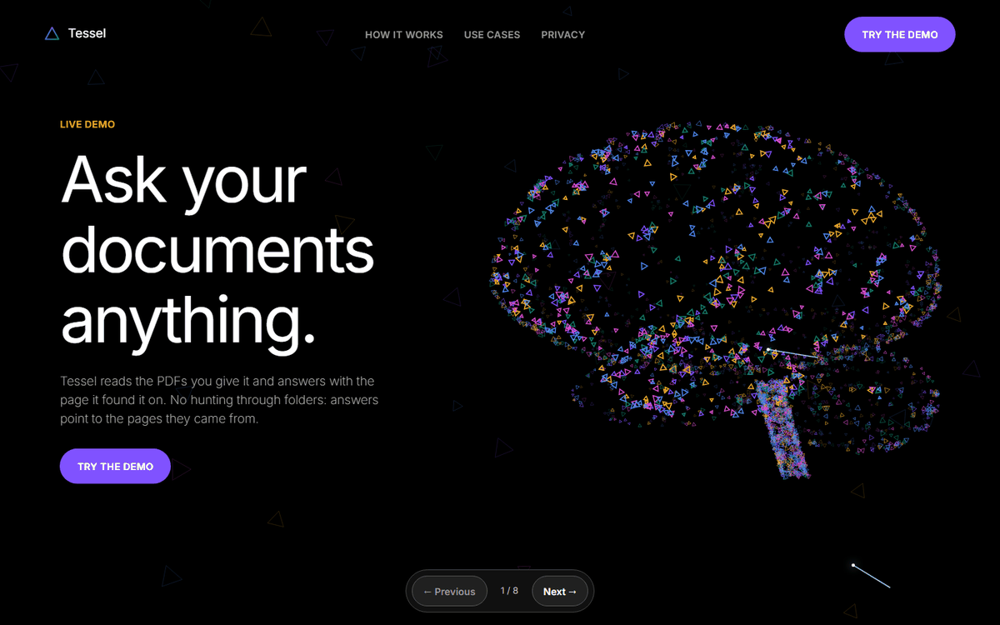
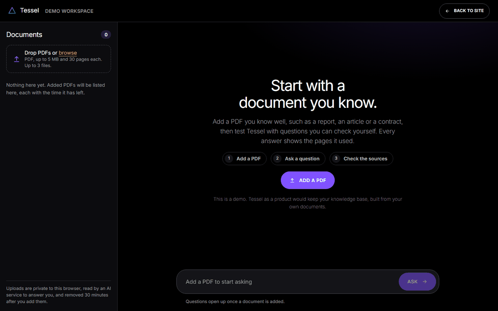
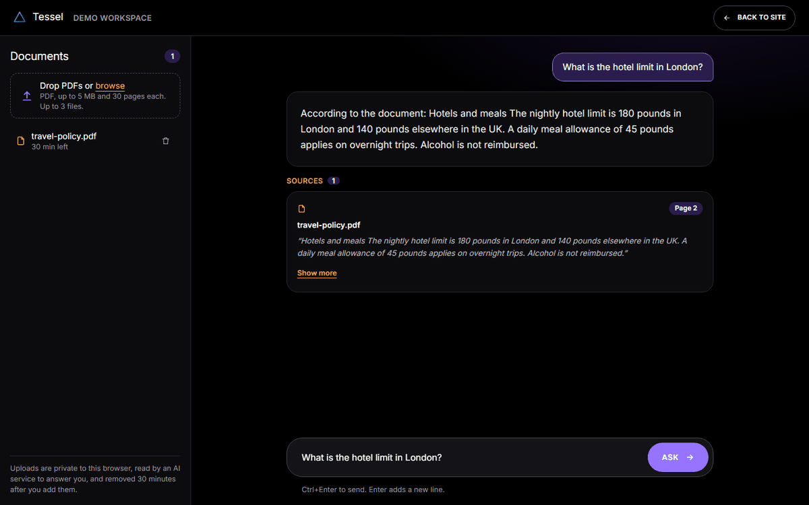

# Tessel

Ask your documents anything. Tessel reads a PDF you upload and answers your questions, showing the exact pages it used.

[](https://github.com/jaredtambua/rag-app/actions/workflows/ci.yml)

**Live demo:** https://rag-app-1-8mtr.onrender.com



This is a demo. Tessel as a product would keep your knowledge base, built from your own documents. The demo keeps nothing: every upload is private to your browser and deleted 30 minutes after you add it.

| First run | An answer with sources |
| --- | --- |
|  |  |

The screenshots were captured on a local copy that uses a built-in stand-in for the AI service (see "Tests" below), so the answer text is a plain quote rather than a written answer.

## How it works

1. You upload a PDF. The server reads the text of each page.
2. The text is cut into overlapping chunks of about 800 characters.
3. Each chunk becomes an embedding (a list of numbers that captures its meaning) from OpenAI's `text-embedding-3-small` model.
4. The embeddings are stored in Chroma, a small vector database, tagged with your private visitor ID.
5. When you ask a question, it is embedded the same way and the closest chunks are found, plus the chunks next to them for context.
6. `gpt-4.1-mini` writes an answer using only that evidence and returns the page and quote behind each claim.

## Stack

- Front end: React 19, Vite, react-markdown.
- Back end: Python, FastAPI, Chroma, PyMuPDF, the OpenAI API.
- Hosting: Render (a static site and a web service).

## Run it locally

You need Python (the project is developed on 3.14.3), Node.js, and an OpenAI API key. The commands below use `cp`; on Windows Command Prompt use `copy` instead.

**Back end** (from the repository root):

```bash
python -m venv .venv
# Windows: .venv\Scripts\activate     macOS or Linux: source .venv/bin/activate
pip install -r backend/requirements.txt
cp backend/.env.example backend/.env        # then put your OpenAI key in backend/.env
cd backend
uvicorn api:app --port 8000
```

**Front end** (in a second terminal):

```bash
cd frontend
npm install
cp .env.example .env                         # points the page at http://localhost:8000
npm run dev
```

Open http://localhost:5173. The dev server always uses port 5173 and refuses to start if it is busy, because the API only allows requests from that address (and the live site).

### Settings

Back end (`backend/.env`, or real environment variables):

| Name | What it does |
| --- | --- |
| `OPENAI_API_KEY` | Your OpenAI key. Required. |
| `ALLOWED_ORIGINS` | Comma-separated list of web addresses allowed to call the API. Defaults to `http://localhost:5173`, `http://127.0.0.1:5173` and the live site. |
| `UPLOAD_TTL_SECONDS` | How long an upload lives. Defaults to 1800 (30 minutes). |
| `DATA_DIR` | Where temporary uploads and the index are kept. Defaults to `backend/data/`, which is emptied every time the server starts. |
| `ENABLE_API_DOCS` | Set to `1` to turn on the `/docs` page. Off by default. |

Front end (`frontend/.env`):

| Name | What it does |
| --- | --- |
| `VITE_API_URL` | Address of the API. It is baked in when the page is built, so set it before `npm run build`. |

## Deployment

The live site uses Render: a static site for the front end and a web service for the API. Nothing here changes Render for you; these are the settings the code expects.

**API (web service, root directory `backend/`):**

- Python version: `backend/.python-version` pins 3.14.3 (Render reads it; you can also set the `PYTHON_VERSION` environment variable).
- Build command: `pip install -r requirements.txt`
- Start command: `uvicorn api:app --host 0.0.0.0 --port $PORT`
- Environment variables: `OPENAI_API_KEY` (required), `ALLOWED_ORIGINS` (only if the front end is on a different address than the default live site). Do not set `FAKE_OPENAI`: the server refuses to start with it on Render.

**Front end (static site, root directory `frontend/`):**

- Build command: `npm ci && npm run build`, publish directory `dist`.
- Environment variable: `VITE_API_URL`, the address of the API. It is read at build time, so changing it needs a rebuild.

## Tests

```bash
pip install -r backend/requirements-dev.txt
pytest                                        # from the repository root
cd frontend && npm run lint && npm run build
```

The tests never call OpenAI. They use `FAKE_OPENAI=1`, a switch that replaces the embeddings and the answer with deterministic stand-ins. You can use the same switch to run the whole app locally without a key (`FAKE_OPENAI=1 uvicorn api:app --port 8000`). The server refuses to start with this switch if it detects Render.

## Demo limits

- Each browser gets a random visitor ID (kept in local storage, not a login). You only ever see and delete your own uploads.
- 5 MB per file, 30 pages per PDF, 3 files at a time, PDF only.
- 20 questions per hour, each up to 500 characters (counted in characters, not bytes).
- Accepted uploads are limited to 10 per hour per visitor, 20 per hour per network address and 40 per hour in total. There are also hourly caps per network address and in total, to keep the demo's cost in check.
- Every upload attempt counts, even a rejected one: 30 attempts per hour per network address and 120 per hour in total. This keeps hostile files from using up the server.
- Each PDF is read in a separate process that is killed after 5 seconds or if it uses more than 350 MB of memory (and fails with a friendly message). At most two PDFs are read at once and one per network address; others are asked to retry. A document may hold at most about 200,000 characters of text and 8 MB of decompressed page data.
- Uploads are removed 30 minutes after you add them, and everything is wiped whenever the server restarts.
- The text of your documents is sent to OpenAI to build the index and write answers, so keep it to files you are comfortable sharing.

## Known limits

- Answer quality has not been tuned. It uses plain vector search, with no keyword search or re-ranking.
- Scanned PDFs (images of text) are not supported; there is no OCR.
- Follow-up questions use the last 5 questions and answers. They are kept only in the visitor's browser (lost on refresh or Clear history); the server stores no history. Earlier answers only help understand the question and are never used as evidence.
- Rate limits live in the server's memory, so they reset when it restarts, and the app assumes a single server.
- The free Render server sleeps when idle, so the first visit can take up to a minute to wake it.
- The tests use stand-ins for OpenAI, so real answer quality is only checked by trying the live demo.

## Roadmap

- A persistent, personal knowledge base per user (accounts, your documents kept between visits).
- Hybrid search and re-ranking for better retrieval.
- Checking answers against their sources.

## Licence

MIT. See [LICENSE](LICENSE).
